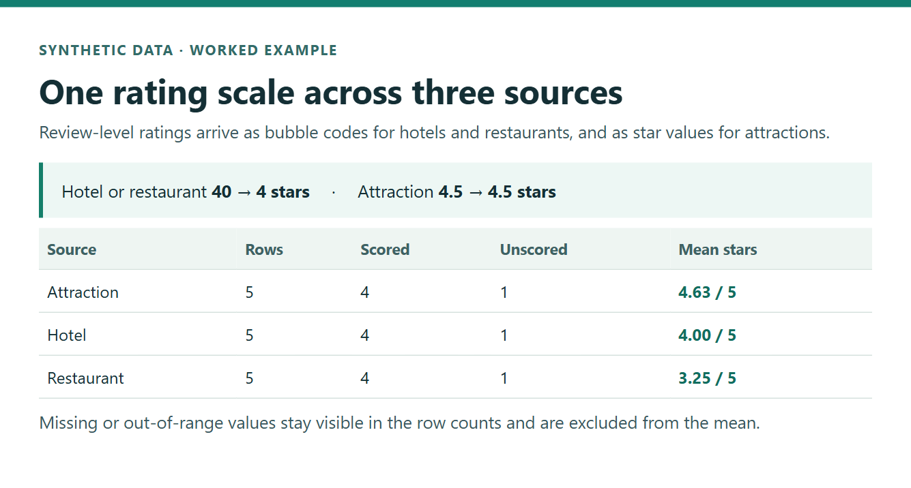

# Exploring Singapore travel reviews with Airflow and Tableau

Which themes recur in reviews of Singapore hotels, restaurants and attractions? This IS3107 project brings three types of TripAdvisor listings into MySQL, scores review sentiment and groups recurring topics for exploration in Tableau.

## A data-quality example you can run offline

A hotel or restaurant review stores a five-star rating as the text `50`. The attraction collector reads a numeric star value such as `5.0`. Averaging those source values together would distort the result. The [SQL query](analysis/review_ratings.sql) normalizes each source at review level before aggregating. Invalid and missing values contribute to the unscored count.

Run `python analysis/demo.py` from the repository root. It creates an in-memory SQLite database, loads [15 synthetic review rows](analysis/mock_reviews.sql) and runs the query. The full Airflow project uses MySQL. The demo needs only Python and makes no network calls.

## Follow a review through the pipeline

1. **Collect listings and reviews.** The Airflow workflow starts a separate branch for each listing type. Once a branch discovers listing links, its detail and review tasks can run independently. [Workflow definition](dags/is3107Dag.py)
2. **Score and group the text.** The sentiment task uses spaCy and TextBlob polarity to update listing-level sentiment ranks. A separate task extracts noun phrases, fits BERTopic and writes topic counts by category to the `ReviewTopic` table. [Sentiment scoring](dags/helpers/sentimentAnalysis.py) · [Topic modelling](dags/helpers/topicAnalysis.py)
3. **Explore the results.** The Tableau workbook connects to MySQL. It contains the dashboard definition and needs a populated database to display the project data. [Tableau workbook](TripAdvisor%20Dashboard.twb)

## Local setup

From the repository root, start Docker and run `docker compose up --build`. The configuration exposes the Airflow UI at `http://localhost:8080` and MySQL on host port `3307`. The `is3107` workflow defines a 30-day schedule. Open the workbook in Tableau Desktop and use the local MySQL settings in the [Compose file](docker-compose.yml).

The collection code targets the TripAdvisor pages used during the course project. A fresh collection depends on the current page structure. To explore the design without collecting reviews, start with the workflow and analysis code above. Stop the local services with `docker compose down`.
